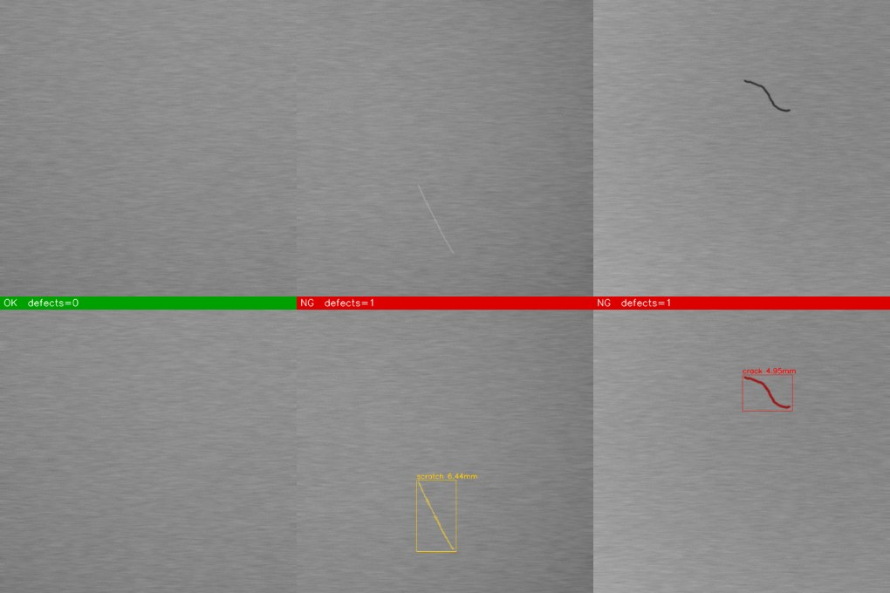
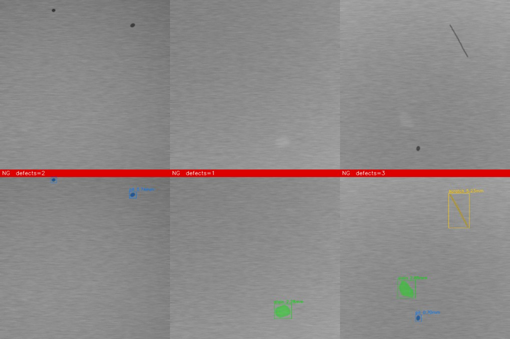

# Industrial Surface Defect Detection & Optical Inspection System

[](../../actions)
 

An end-to-end machine-vision pipeline for automated optical inspection (AOI) of manufactured
surfaces. It finds **scratches, cracks, pits and stains**, measures them in **millimetres**, applies
configurable **accept / reject (OK / NG)** rules and produces annotated images plus JSON / CSV / HTML
reports. It runs on a CPU in ~70 ms per 512×512 frame and needs **no training data to start**.


*Top: input. Bottom: result with classified, measured defects (OK = green banner, NG = red).*



## Features
- **Illumination-robust preprocessing** – sigma-clipped polynomial flat-fielding
- **Unsupervised multi-scale detector** – fine / coarse / Hessian-ridge maps, robust z-scores, hysteresis
- **Metrology in mm** – skeleton length, width, area; camera calibration & undistortion (checkerboard)
- **Two classifiers** – transparent rules, or a Random Forest trained with one command
- **Production hooks** – ROI masks, per-class size limits, defect-count limit, JSON/CSV/HTML output
- **Tooling** – CLI, Streamlit UI, synthetic dataset generator, benchmark harness, tests, CI, Docker

## Quick start
```bash
git clone https://github.com/<your-user>/surface-defect-inspection.git
cd surface-defect-inspection
python -m venv .venv && source .venv/bin/activate      # Windows: .venv\Scripts\activate
pip install -e ".[dev,app]"

python -m sdd.cli inspect examples --out outputs        # inspect the bundled samples
# open outputs/report.html
```

### Everything the CLI does
```bash
python -m sdd.cli generate  --out data/synthetic --n-good 40 --n-bad 160   # labelled synthetic data
python -m sdd.cli evaluate  data/synthetic --out docs/EVAL_RULES.md        # benchmark
python -m sdd.cli train     data/synthetic --out models/classifier.joblib  # optional ML classifier
python -m sdd.cli evaluate  data/synthetic --model models/classifier.joblib
python -m sdd.cli inspect   my_images/ --pixel-size 0.02 --config configs/default.yaml
python -m sdd.cli calibrate calib_images/ --pattern 9x6 --square-mm 5 --out calibration.json
streamlit run app/streamlit_app.py                                         # interactive UI
```

### Python API
```python
import cv2
from sdd import Inspector, InspectionConfig

inspector = Inspector(InspectionConfig(pixel_size_mm=0.02))
result = inspector.inspect(cv2.imread("part.png"))
print(result.verdict, result.reasons)
for d in result.defects:
    print(d.cls, f"{d.length_mm:.2f} mm", d.bbox)
cv2.imwrite("overlay.png", result.overlay())
```

## Results (synthetic benchmark, 200 unseen images: 40 good / 160 defective)
| Metric | Rule-based | + Random Forest |
|---|---|---|
| Defect precision / recall | 1.000 / 0.997 | 1.000 / 0.997 |
| Image-level accuracy (any defect) | 1.000 | 1.000 |
| Classification accuracy | 0.894 | **0.997** |
| Pixel IoU | 0.758 | 0.758 |
| Latency (512×512, 1 CPU core) | ~70 ms | ~90 ms |

Full reports: [`docs/EVAL_RULES.md`](docs/EVAL_RULES.md), [`docs/EVAL_ML.md`](docs/EVAL_ML.md).

> **Honest caveat:** these numbers are on *synthetic* brushed-metal images generated by this repo, so
> they show the pipeline works and is regression-tested — **not** what you will get on your parts.
> Real surfaces have texture, glare and defect types this generator doesn't model. Expect to tune
> thresholds / lighting and retrain the classifier on your own labelled data (see `docs/ARCHITECTURE.md`).

## Project layout
```
sdd/
  config.py       thresholds, accept/reject limits, YAML I/O
  optics.py       checkerboard calibration, undistortion, mm/px
  preprocess.py   robust illumination flat-field
  detect.py       multi-scale anomaly maps + hysteresis segmentation
  classify.py     skeleton/shape features, rule + learned classifier
  pipeline.py     Inspector: detect -> classify -> measure -> verdict -> overlay
  evaluate.py     precision/recall/IoU/confusion benchmark
  report.py       JSON / CSV / HTML reports
  synthetic.py    labelled synthetic surface generator
  cli.py          command line
app/streamlit_app.py   interactive UI           tests/   pytest suite (18 tests)
configs/               YAML config              docs/    architecture + eval reports
```

## Tuning for your line
1. Calibrate scale (`pixel_size_mm`) with a gauge block or the checkerboard command.
2. Run on known-good parts; raise `high_threshold` until false rejects vanish.
3. Run on known-bad parts; lower it / `min_area_px` until misses vanish.
4. Set `max_size_mm` per class to match your drawing/spec; label some regions and `train` a classifier.

## Docker
```bash
docker build -t sdd . && docker run -p 8501:8501 sdd
```

## Tests
```bash
pytest -q        # 18 tests: detection per class, metrology scaling, calibration, CLI, benchmark targets
```

## License
MIT – see [LICENSE](LICENSE).
